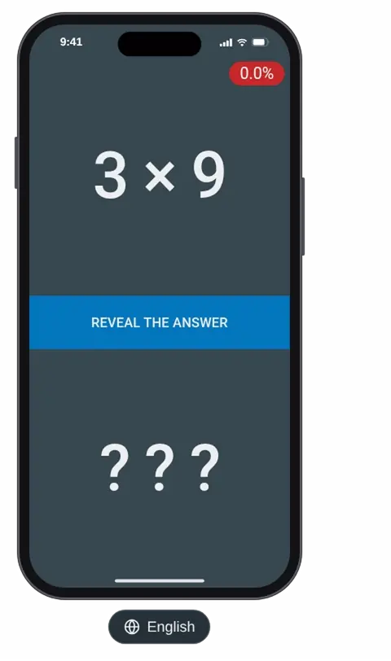

# Mult

[](https://github.com/andrew-markin/mult/actions/workflows/deploy.yml)
[](LICENSE)



Multiplication trainer. A progressive web app that drills the multiplication table from 2 × 2 to
9 × 9, along with division by it, and keeps asking the facts you don't know yet until you do.

**Try it at [mult.mayfleet.com](https://mult.mayfleet.com/).** To use it like an app, offline too,
install it: in Safari on iPhone or iPad tap Share → Add to Home Screen, in Chrome tap Install app
(or Add to Home screen) in the menu.

- **Spaced repetition:** mistakes come back soon, while well-known facts are confirmed less and
  less often.
- **Multiplication and division** mixed in one flow, 128 facts from 2 × 2 to 9 × 9.
- **79 languages**, picked by the browser, with local digits and operation signs.
- **Keyboard friendly:** Space or Enter reveals the answer, the arrow keys grade it.
- **Works offline** once installed. Progress stays on the device: no sign-up, no ads, no
  tracking.
- **Free and open source** under the GPL-3.0.

## How to use

1. Look at the question and answer it in your head.
2. Tap **Reveal the answer** (or press Space / Enter).
3. Be honest: tap **I knew** (→) or **I didn't know** (←). The arrow keys point at the buttons,
   so they swap in right-to-left languages.

The badge in the top corner shows the share of facts whose last answer was correct. Press and
hold it for a second to reset all progress. Progress is kept in the browser's local storage, so
it survives reloads and works offline once the app is installed.

Both `a × b` and `b × a` are asked separately on purpose: recognizing either form is part of the
training. So are both divisions they turn into, `ab ÷ a` and `ab ÷ b`, mixed into the same flow,
128 facts in all. Multiplying by 1 is too trivial to be worth drilling, hence the table starts
with 2.

## Languages

The app speaks the first of the browser's preferred languages it has a translation for, and
switches on the fly when that preference changes. Numbers are formatted for the user's locale, so
for instance Arabic in Egypt gets Eastern Arabic digits, and right-to-left languages get a mirrored
layout, while the arithmetic itself still reads left to right. Translations live in
[`src/locales.js`](src/locales.js): to add a language, add its four strings there, keyed by its
language code (with a region or script when needed, like `pt-PT` or `zh-Hant`). Operation signs are
localized there too, so that, for instance, Russian and German get `6 · 7` and `42 : 7` the way
their schools write them.

## How questions are picked

Every answer advances an iteration counter. For each fact the trainer remembers the iteration it was
last asked at and how many times in a row it was answered correctly. The next question is drawn at
random, weighted as follows (related facts are the ones sharing factors, like 6 × 7, 7 × 6, 42 ÷ 6
and 42 ÷ 7, so that one doesn't give the answer to another away):

| Fact state                                      | Weight                         |
| ----------------------------------------------- | ------------------------------ |
| It or a related fact asked in last 5 iterations | excluded                       |
| Never asked                                     | 100                            |
| Last answer was wrong                           | 50                             |
| Answered correctly less than 20 iterations ago  | 1                              |
| Answered correctly earlier                      | 30 − 3 × min(correct, 9), 27…3 |

So new facts keep flowing in, mistakes come back soon, and well-known facts are confirmed every now
and then, less often the more times they have been confirmed. The rules live in
[`src/trainer.js`](src/trainer.js).

## Development

Requires Node.js 22.22+ or 24.15+.

```sh
npm install
npm run dev      # dev server at http://localhost:8085
npm test         # unit tests (Vitest)
npm run lint     # oxlint + ESLint, with fixes
npm run format   # Prettier
npm run build    # production build into dist/
```

iOS ignores the web app manifest for launch screens, so the build generates plain background
launch images for every iPhone and iPad screen size with
[`plugins/ios-splash-screens.js`](plugins/ios-splash-screens.js). When Apple releases a device with
a new screen size, add it to the list there, otherwise the app launches with a white screen on it.

The animation above is recorded by `npm run demo` with
[`scripts/demo/record.js`](scripts/demo/record.js): it builds the app, plays a scripted session in
headless Google Chrome and encodes the screencast to `assets/demo.webp` with ffmpeg. Record it again
when the interface changes.

## Deployment

Every push to `main` runs the tests, builds the app and publishes it to GitHub Pages via
[GitHub Actions](.github/workflows/deploy.yml), straight from the build with no `gh-pages` branch.
The custom domain is set in the Pages settings of the repository.

## License

[GNU General Public License v3.0](LICENSE)
